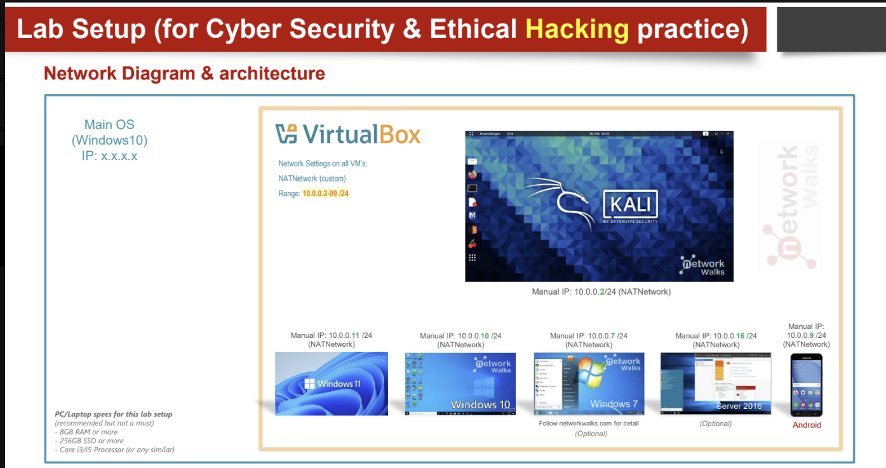
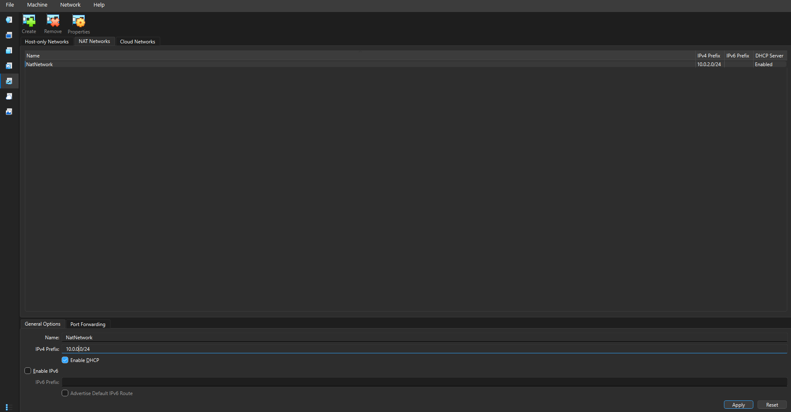
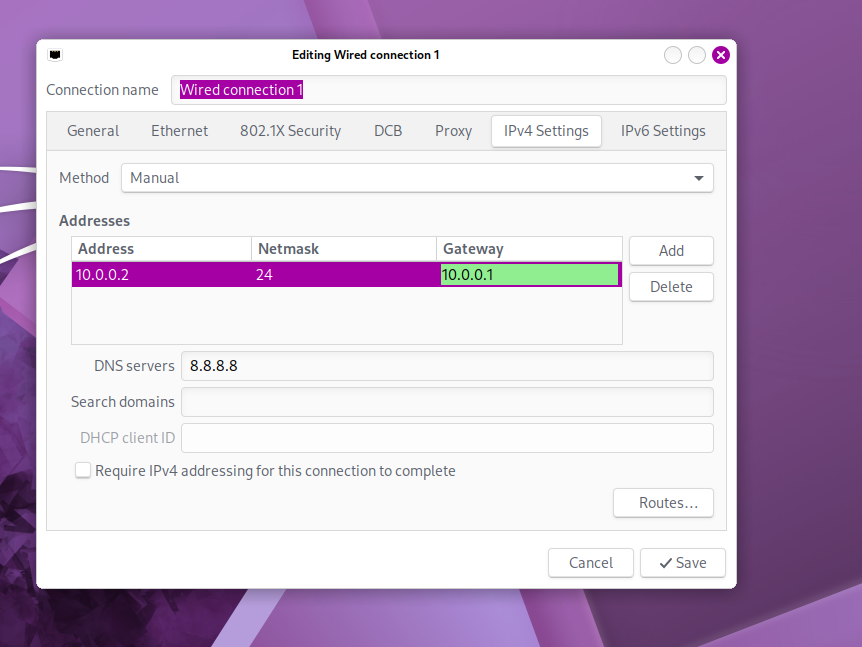

# Cybersecurity Lab Setup

<h3 align="center">Building an isolated virtual lab for penetration testing and ethical hacking practice</h3>

<p align="center">
  
  
  
  
  
  <a href="https://github.com/OlamideB"></a>
  
</p>

## Project Overview

This project focuses on setting up a testing lab with an attacker machine, using VirtualBox and Kali Linux to simulate a controlled environment.

The purpose of this lab is to create a safe cybersecurity testing environment where I can gain hands-on skills with security tools and practice them without risk.

The lab is configured on a NAT Network.

## Objectives

1. Install VirtualBox.
2. Set up Kali Linux as the attacker machine.
3. Set up the network on the 10.0.0.0/24 subnet.
4. Use a NAT Network with 10.0.0.0/24.
5. Verify network connectivity and DNS resolution.
6. Document the procedures.
7. Prepare the environment for future projects.

## Purpose

This lab is used strictly for learning cybersecurity tools and techniques, such as vulnerability assessment, port scanning, packet analysis, and other security tool experiments.

> **Note:** This lab is only for systems I own or have permission to test.

## Lab Architecture

<p align="center">
  
</p>

## Lab Configuration

| Component | Configuration |
|---|---|
| Host OS | Windows 11 |
| Host RAM | 32 GB |
| Processor | Intel Core Ultra 7 |
| Hypervisor | VirtualBox 7.2.4 |
| Security OS | Kali Linux 2026.1 |
| Kali RAM | 8971 MB |
| Virtual Network | NAT Network |
| Network Address | 10.0.0.0/24 |
| Kali IP Address | 10.0.0.2/24 |
| Default Gateway | 10.0.0.1 |
| DNS Server | 8.8.8.8 |

## Lab Procedure

For how to install and configure a virtual machine from scratch, see my [Ubuntu VM install guide](https://github.com/OlamideB/Home-Lab/blob/main/ubuntu-vm-install.md).

### Step 1: Create the NAT Network

A NAT Network was created in VirtualBox (**File > Tools > Network Manager > NAT Networks > Create**).

| Setting | Value |
|---|---|
| Network Name | NatNetwork |
| IPv4 Prefix | 10.0.0.0/24 |
| DHCP | Enabled |
| IPv6 | Disabled |

<p align="center">
  
</p>

**Why NAT Network?** I picked it because it is the only option that does all three things this lab needs:

1. The VMs can talk to each other.
2. The lab is isolated from my home network.
3. The VMs still have internet access.

This means the attacker machine and future target VMs can communicate within the lab.

### Step 2: Attach Kali to the NAT Network

With Kali shut down, I went to **Settings > Network > Adapter 1** and set:

| Setting | Value |
|---|---|
| Enable Network Adapter | Checked |
| Attached to | NAT Network |
| Name | NatNetwork |
| Adapter Type | Intel PRO/1000 MT Desktop |
| Virtual Cable Connected | **Checked** |

<p align="center">
  
</p>

### Step 3: Configure the Kali Linux Network

1. Right-click the network icon on the top right of Kali.
2. Click **Edit Connections**.
3. Select **Wired connection 1** and go to **IPv4 Settings**.
4. Set Method to **Manual** and fill in the IP address based on your network topology:

| Setting | Value |
|---|---|
| IP Address | 10.0.0.2 |
| Subnet Mask | /24 |
| Gateway | 10.0.0.1 |
| DNS | 8.8.8.8 |

<p align="center">
  
</p>

### Step 4: Create a Clean VM Snapshot

A snapshot is a backup, so if anything breaks I can always go back to the clean state.

**To take a snapshot:**
1. Select the Kali machine in VirtualBox.
2. Go to **Snapshots** and click **Take**.
3. Name it, for example: `Clean Kali - Network Setup`

**To restore:**
1. Shut down Kali.
2. Go to **Snapshots** and select `Clean Kali - Network Setup`.
3. Click **Restore**.

## Lab Verification

| Test | Command | Expected Result |
|---|---|---|
| Check network device | `nmcli device status` | eth0 shows connected |
| Check IP address | `ip a` | 10.0.0.2/24 on eth0 |
| Test gateway | `ping -c 4 10.0.0.1` | Successful replies |
| Test internet | `ping -c 4 8.8.8.8` | Successful replies |
| Test DNS | `ping -c 4 google.com` | google.com resolves and replies |

## Problems Encountered and Solutions

### Problem 1: Kali showed "disconnected"

I had a preexisting Kali machine and had to change its configuration. `nmcli device status` showed eth0 as **unavailable**, and ping returned **Network is unreachable**.

**Cause:** Virtual Cable Connected was unchecked in VirtualBox, so Kali saw no network cable.

**Fix:** I turned off Kali, went to the network settings (Step 2 above), and checked **Virtual Cable Connected**. Make sure this box is checked.

### Problem 2: No internet access from Kali

One workaround was to run the following commands:

```
sudo nmcli connection modify "Wired connection 1" ipv4.dad-timeout 0
sudo nmcli connection down "Wired connection 1"
sudo nmcli connection up "Wired connection 1"
```

- The first command turns off Duplicate Address Detection, which can block the IP in VirtualBox 7.
- The second and third commands turn the connection off and back on so the changes apply.

After this, Kali had network connectivity:

```
┌──(olamide㉿kali)-[~]
└─$ ping -c 3 google.com
PING google.com (173.194.45.139) 56(84) bytes of data.
64 bytes from 173.194.45.139: icmp_seq=1 ttl=255 time=19.5 ms
64 bytes from 173.194.45.139: icmp_seq=2 ttl=255 time=20.0 ms
64 bytes from 173.194.45.139: icmp_seq=3 ttl=255 time=20.1 ms

--- google.com ping statistics ---
3 packets transmitted, 3 received, 0% packet loss
```

## What I Learned

### NAT vs NAT Network vs Bridged Adapter

For a long time I did not know why these were different, so today I did my research. NAT keeps a VM on a private network, but it cannot be seen by or shared with other VMs. NAT Network is also private and isolated, but the VMs on it can talk to each other. Bridged Adapter, on the other hand, is not isolated at all. It basically shows up on your home Wi-Fi.

I also learned how network configuration affects the way VMs communicate.

### VM Snapshots

VM snapshots were my highlight. Ever since I started configuring VMs, I never knew I could save a clean slate and go back to it when things don't work out. I wish I had known this sooner, because there were many times I would configure a VM, run into a problem, and end up deleting it and wasting a lot of time getting it back to the way it was.

### Documentation

Documentation is very important to me. Not only does it matter in the professional field, it is also a way for me to keep track of what I have done and learned.

## Author

**Olamide Britto**

LinkedIn: [linkedin.com/in/OlamideBritto](https://www.linkedin.com/in/OlamideBritto/)